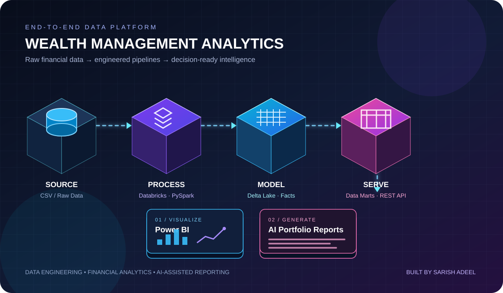

<div align="center">


# ✦ Wealth Management Analytics Platform

### A data-to-decisions experience — built with engineering, analytics & AI

**Designed and developed by Sarish Adeel**


<br/>

[Explore the Repository](https://github.com/sarishadeel206/Wealth-Management-Analytics) · [View Source](https://github.com/sarishadeel206/Wealth-Management-Analytics/tree/main)

</div>

---

<div align="center">

## ◈ THE BIG PICTURE



<sub>From raw financial records to organized data products and business-ready insights.</sub>

</div>

---

## ▰ Project Overview

The **Wealth Management Analytics Platform** is an end-to-end data engineering and analytics project developed during a Data Engineering & AI Internship. It transforms sample wealth-management datasets into structured warehouse tables, analytical Data Marts, API-accessible data, Power BI dashboards, and AI-assisted HTML portfolio reports.

> **The core idea:** Build a connected pipeline where financial data is cleaned, modeled, served, visualized, and presented in a useful format.

## ✧ What It Can Do

<table>
<tr>
<td width="50%" valign="top">

### ◉ 01 — Engineer
Clean, transform, and prepare raw financial datasets using **Databricks and PySpark**.

### ◉ 02 — Model
Create **Fact and Dimension tables** to organize data for reliable analytical queries.

### ◉ 03 — Store
Use **Delta Lake tables** as the structured warehouse layer.

</td>
<td width="50%" valign="top">

### ◉ 04 — Serve
Prepare purpose-built **Data Marts** and expose selected data through **Node.js / Express REST APIs**.

### ◉ 05 — Visualize
Present key wealth-management metrics through an **executive Power BI dashboard**.

### ◉ 06 — Generate
Use the **OpenRouter API** to turn supplied portfolio data into structured HTML reports.

</td>
</tr>
</table>

## ⬡ How the Data Moves

<div align="center">

| LAYER | WHAT HAPPENS | OUTPUT |
|:---:|---|---|
| **01 · SOURCE** | Read raw sample CSV files | Source datasets |
| **02 · TRANSFORM** | Clean and process data with Databricks + PySpark | Prepared datasets |
| **03 · MODEL** | Build Facts, Dimensions and Delta tables | Structured warehouse |
| **04 · SERVE** | Create analytical Data Marts and REST endpoints | Query-ready data / JSON |
| **05 · PRESENT** | Build Power BI views and AI-assisted HTML reports | Business insights |

</div>

## ▦ Analytics Studio

The platform contains analytical views designed around different wealth-management questions.

| DATA MART / ANALYSIS | BUSINESS QUESTION IT SUPPORTS |
|---|---|
| **Executive Dashboard** | What is the overall business snapshot? |
| **Client Portfolio Summary** | What does the client-level portfolio overview look like? |
| **Advisor Performance** | How can advisor-related activity be reviewed? |
| **Scheme Performance** | How are schemes represented across key metrics? |
| **Revenue Analytics** | What revenue trends and summaries are visible? |
| **SIP Analytics** | What does SIP activity look like? |
| **Redemption Analytics** | How can redemption activity be explored? |
| **AMC Analytics** | How can Asset Management Company data be compared? |

## ◈ Executive Dashboard

The Power BI dashboard uses the Executive Dashboard Mart to bring important measures into one place:

<div align="center">

| CLIENTS & ADVISORS | ASSETS UNDER MANAGEMENT | INVESTMENT & REDEMPTION | REVENUE | ACTIVE PRODUCTS |
|:---:|:---:|:---:|:---:|:---:|
| Total Clients<br/>Total Advisors | Total AUM | Total Investment<br/>Total Redemption | Total Revenue | Active SIPs<br/>Active Schemes |

</div>

These indicators offer a consolidated view of key wealth-management activity. Actual values depend on the sample data loaded into the project.

## ⇄ REST API Layer

The backend uses **Node.js and Express.js** to expose selected Data Mart data through REST endpoints. The endpoints return structured JSON for downstream applications and reporting workflows.

<div align="center">

**API REQUEST**　→　**EXPRESS.JS ENDPOINT**　→　**DATA MART**　→　**JSON RESPONSE**

</div>

API behavior was tested using **Postman**. The API workflow connects prepared analytical data to applications that need to consume it.

## ✺ AI-Assisted Portfolio Reporting

Portfolio data retrieved through the API is sent to an AI model via the **OpenRouter API**, which generates a structured HTML wealth-management report.

- Organizes supplied portfolio information into a readable report format.
- Helps present data clearly for review.
- Depends on the data and context supplied to the model.

> **Responsible-use note:** Generated reports are informational and are not regulated financial advice. The model should not be treated as a source of verified financial facts, and missing values should not be assumed.

## ⬢ Technology Stack

<div align="center">

| ENGINEERING AREA | TOOLS |
|---|---|
| **Data Engineering** | Databricks · Apache Spark · PySpark |
| **Storage & Warehouse** | Delta Lake · Fact & Dimension Modeling |
| **Data Products** | Analytical Data Marts |
| **Backend & APIs** | Node.js · Express.js · REST APIs |
| **API Testing** | Postman · Databricks SQL Connector |
| **Analytics & Visualization** | Power BI · Python |
| **AI Integration** | OpenRouter API |
| **Development Workflow** | GitHub · GitHub Desktop · Visual Studio Code |

</div>

## ⌘ Repository Map

```text
Wealth-Management-Analytics/
├── assets/
│   └── wealth-analytics-3d.svg     # Custom architecture visual
├── Source_Code/
│   └── Node.js and REST API source files
├── Dimension_Tables/
│   └── PySpark dimension table notebooks
├── Fact_Tables/
│   └── PySpark fact table notebooks
├── Mart/
│   └── Analytical Data Mart notebooks
├── PowerBI_Dashboard/
│   └── Power BI dashboard files
├── Screenshots/
│   └── Project outputs and visualizations
└── README.md
```

## ⤴ Future Enhancements

- Integrate real-time market data sources.
- Add advanced portfolio-risk analytics.
- Automate dashboard refreshes and pipeline monitoring.
- Implement authentication and authorization for APIs.
- Deploy the platform on cloud infrastructure.
- Expand AI-generated insights and report-delivery workflows.

## About the Creator

**Sarish Adeel** — Data Analytics · Data Engineering · AI/ML

This project demonstrates practical work across data pipelines, dimensional modeling, Data Marts, REST APIs, business intelligence, and AI-assisted reporting.

<div align="center">

### ✦ ENGINEERING DATA. DESIGNING INSIGHTS. ✦

<sub>Databricks · PySpark · Delta Lake · Power BI · REST APIs · Generative AI</sub>

<br/>

<sub>Datasets used in this project are sample/dummy datasets intended for educational and internship project purposes.</sub>

</div>